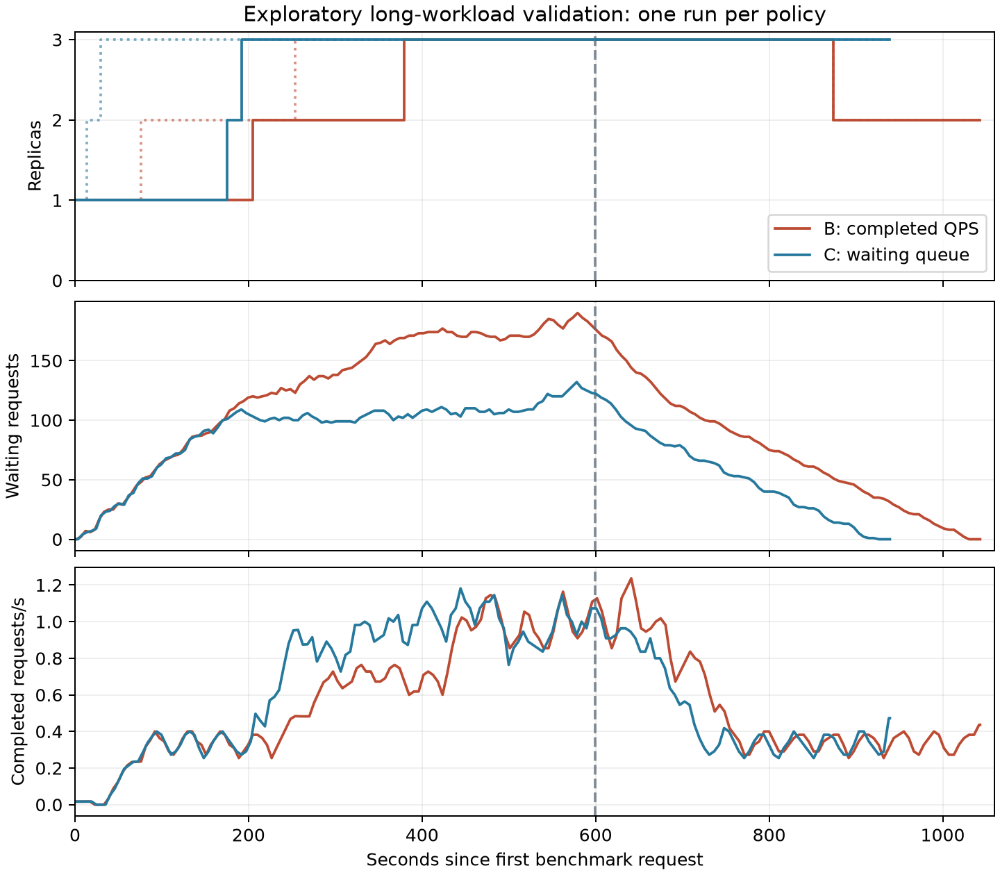

# Exploratory B/C long-workload validation

These are single validation runs, not a calibrated research comparison.
Both used 600 requests, configured 1 request/s for 600 seconds, long inputs,
200 output tokens, seed 100, and the in-cluster collector. Saved token totals
match: 3,617,400 input tokens and 120,000 output tokens per run. Configured
thresholds were 0.2 completed requests/s for B and 2 waiting requests for C;
these thresholds have not received equal calibration effort.

Time zero is each run's first recorded benchmark request. Solid replica curves
show ready capacity; dotted curves show allocated pod GPU replicas. Dashed
vertical lines mark the last benchmark dispatch, approximately 599 seconds
in both runs. No samples are extrapolated after the collector ends.

| Measure | B completed QPS | C waiting queue |
|---|---:|---:|
| Completed / attempted | 600 / 600 | 600 / 600 |
| TTFT p50 (s) | 102.11 | 44.91 |
| TTFT p99 (s) | 436.28 | 333.64 |
| TTFT SLO attainment | 4.50% | 10.83% |
| Allocated GPU-hours | 0.741 | 0.780 |
| Sampled peak waiting | 190 | 132 |
| HPA rescale to 2, seconds after first request | 68.6 | 10.2 |
| HPA rescale to 3, seconds after first request | 248.6 | 25.2 |
| Additional pod startup durations (s) | 130, 126 | 161, 160 |

The rescale times come from SuccessfulRescale events within each run's own
measurement interval, not earlier events retained in the namespace. Kubernetes
event timestamps have second precision; remote clock calibration and scrape
intervals add uncertainty. Nearby metric samples are not exact controller inputs.

## Observations and interpretation

C requested additional capacity earlier in this pair, despite its new pods
taking longer to start. This supports investigating detection/control timing
separately from startup duration. It does not isolate the metric from threshold
choice and temporal smoothing: B uses a one-minute completion-rate window.

B also requested a reduction from three to two at approximately +864.6 seconds.
The nearest serving sample showed 56 waiting requests and completed QPS 0.345.
A later sample showed two ready replicas with 51 waiting requests. This is
consistent with a completion-rate-only policy reducing desired capacity while
backlog remains. It is an observed validation event, not evidence that all
QPS policies inevitably behave this way. C retained three ready replicas
through the end of collection.

Both runs accumulated waiting work even after reaching three ready replicas.
Thus earlier scaling alone did not eliminate overload or meet the two-second
SLO for most requests. The capacity ceiling, workload intensity, routing,
per-replica admission and cache behavior all require examination. Aggregate
KV occupancy or queue data alone cannot establish the causal bottleneck.

## Next experiment decisions

1. Preserve these runs as validation; do not include them as already calibrated
   research repeats or selectively replace poor outcomes.
2. Inspect per-replica waiting/running/cache series and assignment balance before
   attributing continued backlog to insufficient aggregate capacity.
3. Measure fixed-three-replica behavior under the same long workload. This
   separates startup/control effects from sustained-capacity/routing limits.
4. Define comparable threshold calibration budgets and criteria; then freeze
   thresholds and run matched workloads with repeated, rotated treatment order.

## Evidence

- [B run](../results/full-validation-B-long-1/long_B_run1/run.json),
  [metrics](../results/full-validation-B-long-1/long_B_run1/metrics.json),
  [scaling snapshots](../results/full-validation-B-long-1/long_B_run1/scaling.json)
- [C run](../results/full-validation-C-4/long_C_run1/run.json),
  [metrics](../results/full-validation-C-4/long_C_run1/metrics.json),
  [scaling snapshots](../results/full-validation-C-4/long_C_run1/scaling.json)

This note does not establish novelty, general superiority, or AWS bill savings.
No further cloud experiments were launched to produce this analysis.
